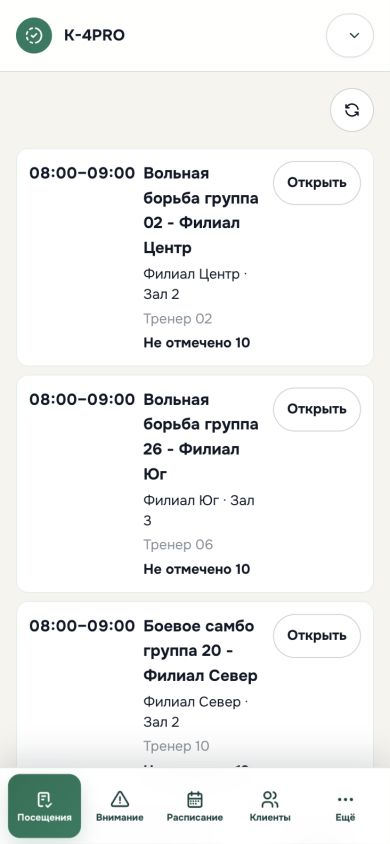

# Посещения — занятия на сегодня

Дата: 20.11.2026. Статус: входящий аналитический материал; не план реализации.

## Задача и границы

Роль: Главный тренер. Найти занятие и перейти к отметкам.

Экспертный проход работающего локального интерфейса. Обозначения: **О** — пройденный путь до указанной границы; **Р** — расчёт по видимым контролам, без сохранения; **Г** — гипотеза предлагаемого пути. Методика и ограничения — в [общем отчёте](../README.md).

## Действия до результата

О: из открытого списка до состава выбранного занятия — 1 нажатие «Открыть». Р: одна отметка из списка — 2 нажатия (открыть занятие → «Был»/«Не был»), если клиент уже виден; прокрутка считается отдельно. Г: сохранить 2, сократить визуальный поиск нужного занятия.

## Находки и приоритет

- **ATT-L-01 · medium · гипотеза:** перед списком отдельная строка почти только с «Обновить список». Она расходует первый экран без помощи в выборе занятия. Совместить обновление с компактным контекстом «Сегодня, 20 ноября».
- **ATT-L-02 · medium · гипотеза:** у Главного тренера 16 занятий разных филиалов идут одним списком с начала дня. Вечернее занятие находится ниже нескольких экранов. Предложить фильтр филиала или переход к ближайшему времени; не менять серверное включение занятий и не скрывать неотмеченные утренние занятия.
- Полезная часть уже есть: время, группа, зал/филиал, тренер и число неотмеченных. Эти данные не являются мусором.

## Что оставить, скрыть и убрать

Оставить: время, идентификацию группы, место, число неотмеченных, открытие. Скрыть по запросу: только второстепенные данные, если роль/выбранный фильтр делает их очевидными. Повтор филиала внутри названия группы часто приходит из самих данных: не обрезать названия программно по предположению.

## Предлагаемый каркас

[Сегодня · дата] [Филиал?] [Обновить] → время / группа / зал / не отмечено / Открыть.

Это текстовая гипотеза, не проверенный и не согласованный прототип.

## Проверка и критерии следующего прохода

Проверен непустой список HeadCoach и пустое состояние Administrator. Заголовок «На сегодня всё отмечено» при отсутствии доступных занятий может смешивать завершённость и отсутствие доступа: отдельная гипотеза для проверки серверных состояний. Не заявлено, что все занятия клуба отмечены.

## Requirements и связи

none — этот отчёт фиксирует наблюдения и предложения; поведение продукта, принятые требования и статусы задач не изменяются. Ограничивающие источники для последующей доработки:

- [04-посещения.md](../../../../docs/requirements/04-посещения.md)
- [TASK-168-attendance-today-worklist.md](../../../done/2026-09-02/TASK-168-attendance-today-worklist.md)

## Доказательства

- [desktop.jpg](desktop.jpg) · [структура экрана](desktop.txt)
- [mobile.jpg](mobile.jpg) · [структура экрана](mobile.txt)

[К общему отчёту и очередности](../README.md)
