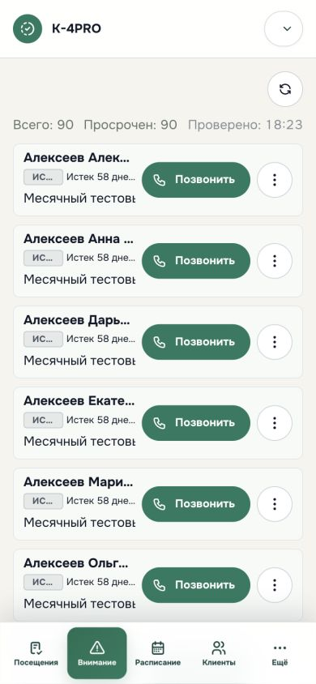

# Внимание

Дата: 20.11.2026. Статус: входящий аналитический материал; не план реализации.

## Задача и границы

Роль: Главный тренер. Выбрать нужного клиента, понять причину и связаться с ним.

Экспертный проход работающего локального интерфейса. Обозначения: **О** — пройденный путь до указанной границы; **Р** — расчёт по видимым контролам, без сохранения; **Г** — гипотеза предлагаемого пути. Методика и ограничения — в [общем отчёте](../README.md).

## Действия до результата

О: доступ к карточке — 2 нажатия: меню строки → «Открыть карточку …». Р: запуск звонка — 1 нажатие; сам звонок не выполнялся. Г: оставить звонок в 1 действие, сделать карточку доступной по имени за 1 вместо 2. Поиск среди 90 строк сейчас требует просмотра/прокрутки; время не измерялось.

## Находки и приоритет

- **ATN-01 · high · подтверждённое затруднение:** на 360/390 px большая кнопка звонка и меню оставляют имени и причине слишком мало ширины. Видны «Алексеев А…», «И…», «Истек 58…»; соседних однофамильцев трудно различить до звонка. Проверено также на 420/440. Контракт: сохранять идентификацию и читаемую причину. Исправление: имя и причина полной строкой сверху, действия отдельно снизу либо компактнее при сохранении цели 44×44.
- **ATN-02 · medium · гипотеза:** на desktop в одной вторичной строке собраны тариф, группа с филиалом, телефон и комментарий. Они имеют разную ценность, но одинаковый вес. Оставить телефон и нужный контекст; комментарий сделать раскрываемым при сохранении доступности.
- **ATN-03 · medium · гипотеза:** нет поиска/сужения 90 клиентов, а «Всего: 90» и «Просрочен: 90» повторяют размер текущей выборки. Поиск и фильтр причины полезнее отдельного набора статических счётчиков; это новый продуктовый выбор.

## Что оставить, скрыть и убрать

Оставить: ФИО, все серверные причины, телефон/Telegram, действие связи. Объединить «ИСТЕК» и «Истек 58 дней назад» в одну читаемую формулировку. Комментарий не удалять: он прямо требуется REQ-ATTN-001; раскрытие вместо постоянного показа согласовать. Не удалять клиента из списка из-за свёрнутой причины.

## Предлагаемый каркас

ФИО полностью → «Абонемент истёк 58 дней назад» → телефон / группа → [Позвонить] [Карточка] [Ещё].

Это текстовая гипотеза, не проверенный и не согласованный прототип.

## Проверка и критерии следующего прохода

Проверить длинные ФИО, несколько причин, отсутствующий телефон, Telegram, возврат к той же строке и 360/390/420/440. Проверка звонка/сообщения и состояния «Связались» не выполнялась.

## Requirements и связи

none — этот отчёт фиксирует наблюдения и предложения; поведение продукта, принятые требования и статусы задач не изменяются. Ограничивающие источники для последующей доработки:

- [10-внимание-и-чат.md](../../../../docs/requirements/10-внимание-и-чат.md)
- [TASK-163-attention-density.md](../../../done/2026-08-30/TASK-163-attention-density.md)

## Доказательства

- [desktop.jpg](desktop.jpg) · [структура экрана](desktop.txt)
- [mobile-360.jpg](mobile-360.jpg) · [структура экрана](mobile-360.txt)
- [mobile-420.jpg](mobile-420.jpg) · [структура экрана](mobile-420.txt)
- [mobile-440.jpg](mobile-440.jpg) · [структура экрана](mobile-440.txt)
- [mobile.jpg](mobile.jpg) · [структура экрана](mobile.txt)

[К общему отчёту и очередности](../README.md)
