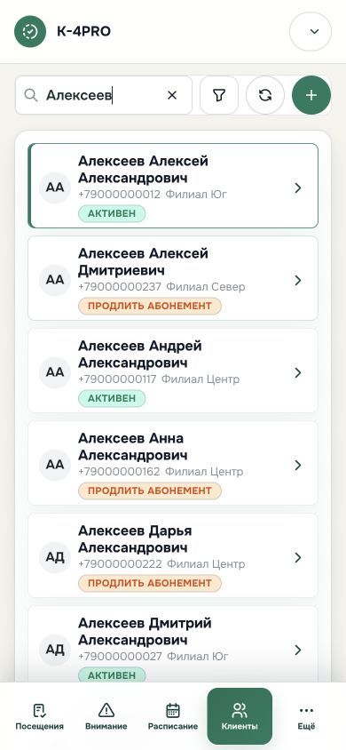

# Клиенты — поиск и список

Дата: 20.11.2026. Статус: входящий аналитический материал; не план реализации.

## Задача и границы

Роль: Главный тренер. Найти конкретного клиента и открыть его данные.

Экспертный проход работающего локального интерфейса. Обозначения: **О** — пройденный путь до указанной границы; **Р** — расчёт по видимым контролам, без сохранения; **Г** — гипотеза предлагаемого пути. Методика и ограничения — в [общем отчёте](../README.md).

## Действия до результата

О: фамилия → строка → «Открыть карточку» = 3 действия до полной карточки (ввод строки считается одним действием). О: запрос «Алексеев Алексей» даёт пустую выдачу; замена на «Алексеев» добавляет 1 исправление. Г: успешный поиск по отображаемому имени без повторного ввода; прямое открытие полной карточки по выбранному сценарию может дать 2 вместо 3.

## Находки и приоритет

- **CLI-01 · high · подтверждено:** поиск «Алексеев Алексей» не находит клиента, которого поиск «Алексеев» показывает как «Алексеев Алексей Дмитриевич». Снимки mobile-search и mobile-surname фиксируют обе стороны. REQ-CLI-008 требует поиска по ФИО. Причина в реализации поиска здесь не устанавливалась.
- **CLI-02 · medium · гипотеза:** desktop повторяет «Планово», «Срочных действий нет», «Нет визитов» и статус «Активный» у большого числа строк. Оставить различающие статусы и следующее действие, нейтральную норму подавать тише.
- Мобильные строки уже заметно проще настольных: переносить в них все настольные подробности не нужно.

## Что оставить, скрыть и убрать

Оставить: ФИО, телефон для различения, филиал и значимое состояние абонемента. Объединить «Без абонемента» / «Оформление не начато» / «Нет текущего абонемента». Скрыть нейтральные нулевые визиты до карточки. Не смешивать активность клиента с действительностью абонемента.

## Предлагаемый каркас

[Поиск по ФИО или телефону] [Фильтры] [+] → имя / контакт / филиал / значимый статус.

Это текстовая гипотеза, не проверенный и не согласованный прототип.

## Проверка и критерии следующего прохода

После исправления: ФИО целиком и частями, пробелы, телефон, однофамильцы, пустой результат, возврат фильтров/прокрутки. Сейчас успешное создание/редактирование не выполнялось.

## Requirements и связи

none — этот отчёт фиксирует наблюдения и предложения; поведение продукта, принятые требования и статусы задач не изменяются. Ограничивающие источники для последующей доработки:

- [01-клиенты.md](../../../../docs/requirements/01-клиенты.md)
- [ClientsListScreen.tsx](../../../../frontend/src/features/clients/list/ClientsListScreen.tsx)

## Доказательства

- [desktop.jpg](desktop.jpg) · [структура экрана](desktop.txt)
- [mobile-search.jpg](mobile-search.jpg) · [структура экрана](mobile-search.txt)
- [mobile-surname.jpg](mobile-surname.jpg) · [структура экрана](mobile-surname.txt)
- [mobile.jpg](mobile.jpg) · [структура экрана](mobile.txt)

[К общему отчёту и очередности](../README.md)
