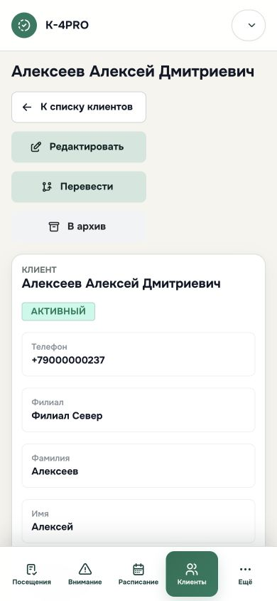

# Полная карточка клиента

Дата: 20.11.2026. Статус: входящий аналитический материал; не план реализации.

## Задача и границы

Роль: Главный тренер. Увидеть состояние клиента и выполнить конкретную операцию без просмотра всех разделов.

Экспертный проход работающего локального интерфейса. Обозначения: **О** — пройденный путь до указанной границы; **Р** — расчёт по видимым контролам, без сохранения; **Г** — гипотеза предлагаемого пути. Методика и ограничения — в [общем отчёте](../README.md).

## Действия до результата

О: из краткой карточки до полной — 1. До открытой формы продления — ещё 1, плюс поиск ниже блока профиля. Г: одна видимая основная операция в компактной шапке; число нажатий может остаться тем же, но потребуется меньше прокрутки. Ускорение по времени не измерено.

## Находки и приоритет

- **DET-01 · medium · подтверждённые повторы:** ФИО дважды крупно и ещё по трём полям; группы в профиле и отдельном блоке; посещения нулём, пустым последним визитом и пустой историей; Telegram дважды сообщает об отсутствии подключения и даёт две «Ссылка и QR».
- **DET-02 · high · гипотеза приоритета:** техническая карточка фото занимает большой блок, хотя снимок не отображается. MIME, килобайты, дата загрузки и перечень форматов не помогают продлить абонемент. Перенести в режим работы с фото; причину недоступности и восстановление сохранить.
- **DET-03 · medium · гипотеза:** перенос группы в абонементах открыт постоянно рядом с текущей продажей; история версий и пустые комментарии смешаны с действием продления. Редкая операция должна открываться по запросу.
- Реальных вкладок внутри текущей полной карточки нет: все разделы выстроены подряд. Предложение вкладок уже есть в TASK-019.

## Что оставить, скрыть и убрать

Оставить наверху: имя, связь, филиал, действующий/истёкший абонемент и основное действие. По запросу: история продаж, история посещений, группы, контакты, Telegram, фото. Убрать пояснения «Блок показывает…», повторные заголовки и технические метки. Не удалять историю, заметки и контакты из данных.

## Предлагаемый каркас

Компактная шапка → текущий абонемент + [Продлить] → «Данные / Посещения / История / Общение» (гипотеза структуры) → вторичные операции внутри соответствующего раздела.

Это текстовая гипотеза, не проверенный и не согласованный прототип.

## Проверка и критерии следующего прохода

Сравнить клиента с фото/без фото/ошибкой фото, нулевой и длинной историей, Telegram подключён/нет, взрослого и клиента с контактами. Проверить доступность предупреждений и возврат из операции. Текущий screenshot-full содержит нижние блоки.

## Requirements и связи

none — этот отчёт фиксирует наблюдения и предложения; поведение продукта, принятые требования и статусы задач не изменяются. Ограничивающие источники для последующей доработки:

- [TASK-018-client-detail-visual-noise.md](../../../tasks-ready/TASK-018-client-detail-visual-noise.md)
- [TASK-019-client-card-tabs.md](../../../tasks-ready/TASK-019-client-card-tabs.md)
- [TASK-020-client-empty-states-action-reasons.md](../../../risky/TASK-020-client-empty-states-action-reasons.md)
- [01-клиенты.md](../../../../docs/requirements/01-клиенты.md)
- [10-внимание-и-чат.md](../../../../docs/requirements/10-внимание-и-чат.md)

## Доказательства

- [desktop-full.jpg](desktop-full.jpg) · полный снимок страницы
- [desktop.jpg](desktop.jpg) · [структура экрана](desktop.txt)
- [mobile-overview.jpg](mobile-overview.jpg) · [структура экрана](mobile-overview.txt)

[К общему отчёту и очередности](../README.md)
