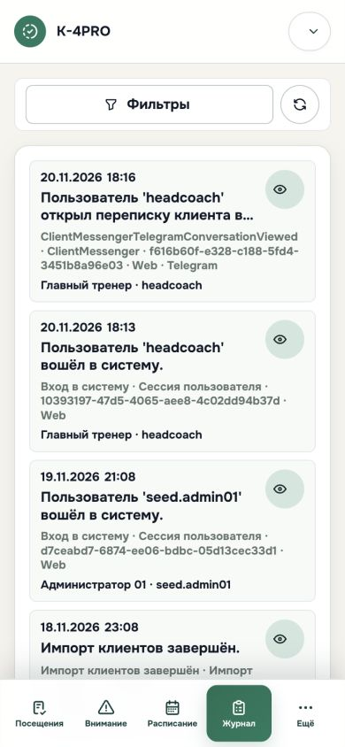

# Журнал — список

Дата: 20.11.2026. Статус: входящий аналитический материал; не план реализации.

## Задача и границы

Роль: Главный тренер. Найти событие, понять кто и что сделал, при необходимости открыть подробности.

Экспертный проход работающего локального интерфейса. Обозначения: **О** — пройденный путь до указанной границы; **Р** — расчёт по видимым контролам, без сохранения; **Г** — гипотеза предлагаемого пути. Методика и ограничения — в [общем отчёте](../README.md).

## Действия до результата

О: открыть детали видимой записи — 1, закрыть Escape — 1. Р: на телефоне открыть фильтры → заполнить F полей → закрыть панель → детали = F+3 действий; конкретный набор фильтров не проходился. Г: сохранить доступ к деталям за 1, освободить строки от технических метаданных.

## Находки и приоритет

- **AUD-01 · medium · подтверждено:** рядом с описанием в списке постоянно выводятся техническое действие, тип объекта, UUID и источник. На телефоне описание обрезается, а метаданные занимают несколько строк. REQ-AUD-002 переносит тип действия в детали и требует компактных строк. Перенести техническую строку в «Детали», сохранив поиск/разбор события.
- **AUD-02 · medium · подтверждено:** названия ClientMessengerTelegramConversationViewed и ClientNoteChanged видны пользователю как коды. Локализовать тип в пользовательском представлении; исходный код оставить технической деталью.
- **AUD-03 · low · гипотеза:** автор повторяется внутри описания и отдельным полем. Не переписывать аудиторский факт; визуально отдавать приоритет одному полю автора.

## Что оставить, скрыть и убрать

Оставить: дата/время, понятное описание, ФИО автора, детали. Скрыть UUID, Web, enum-коды в деталях. При длинном описании разрешить больше строк вместо приоритета техническому хвосту.

## Предлагаемый каркас

[Фильтры] [Обновить] → дата / описание / автор / [Детали].

Это текстовая гипотеза, не проверенный и не согласованный прототип.

## Проверка и критерии следующего прохода

Проверен диалог и возврат фокуса на его кнопку после Escape. Не выполнены screen reader, полная клавиатурная матрица, измерения контраста. Проверить локализацию неизвестного типа и не терять исходные значения в деталях.

## Requirements и связи

none — этот отчёт фиксирует наблюдения и предложения; поведение продукта, принятые требования и статусы задач не изменяются. Ограничивающие источники для последующей доработки:

- [06-аудит.md](../../../../docs/requirements/06-аудит.md)
- [08-нефункциональные.md](../../../../docs/requirements/08-нефункциональные.md)
- [TASK-107-audit-log-mobile-density-focus.md](../../../done/2026-08-22/TASK-107-audit-log-mobile-density-focus.md)

## Доказательства

- [desktop.jpg](desktop.jpg) · [структура экрана](desktop.txt)
- [mobile.jpg](mobile.jpg) · [структура экрана](mobile.txt)

[К общему отчёту и очередности](../README.md)
