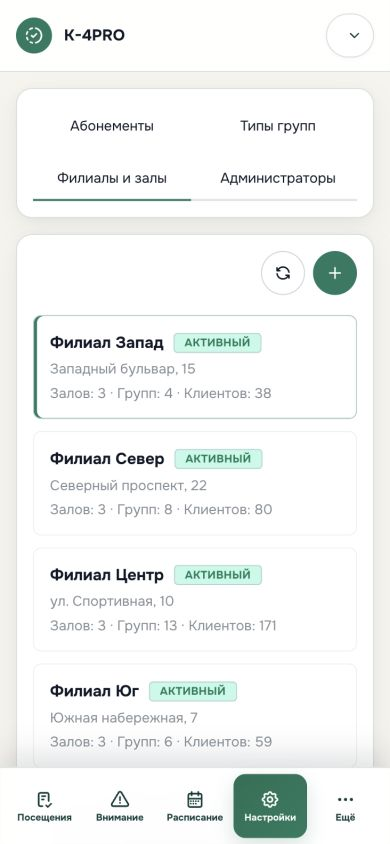

# Настройки — Филиалы и залы

Дата: 20.11.2026. Статус: входящий аналитический материал; не план реализации.

## Задача и границы

Роль: Главный тренер. Выбрать филиал и изменить нужный зал.

Экспертный проход работающего локального интерфейса. Обозначения: **О** — пройденный путь до указанной границы; **Р** — расчёт по видимым контролам, без сохранения; **Г** — гипотеза предлагаемого пути. Методика и ограничения — в [общем отчёте](../README.md).

## Действия до результата

О: сменить выбранный филиал — 1 нажатие. Р: другой филиал → редактирование зала → изменение → сохранить = 4 действия, плюс прокрутка на телефоне. Г: сохранить 4, показывать выбранный филиал и его залы сразу, без повторного просмотра списка.

## Находки и приоритет

- **BRN-01 · medium · гипотеза:** мобильная страница последовательно показывает все филиалы и затем подробности выбранного. После выбора «Филиал Север» детали остаются ниже списка; связь выбора с результатом требует прокрутки. Сравнить компактный выбор филиала или отдельный экран деталей с возвратом.
- **BRN-02 · medium · гипотеза:** каждый зал содержит описание и три равнозначные иконки — редактирование, архивирование, удаление. Редактирование оставить видимым, редкие опасные операции перенести в меню, сохранив подтверждения и причины запрета.
- **BRN-03 · low · гипотеза:** «Зал выбирается в форме тренировочной группы» — постоянная инструкция, полезная при первом знакомстве. Перенести в справку/пустое состояние.

## Что оставить, скрыть и убрать

Оставить адрес и состояние филиала, выбранный филиал, залы и количество связанных групп при влиянии на операции. Не удалять адреса и реальные описания из данных. Тестовые тексты не являются доказательством ненужности поля описания.

## Предлагаемый каркас

[Выбранный филиал] → адрес / состояние / изменить → залы: название / состояние / группы / [Изменить] [Ещё].

Это текстовая гипотеза, не проверенный и не согласованный прототип.

## Проверка и критерии следующего прохода

Проверены выбор другого филиала и непустые залы. После доработки: архивный филиал, пустой список, запрет удаления связанного зала, возврат и подтверждение области действия. Архивирование/удаление не запускались.

## Requirements и связи

none — этот отчёт фиксирует наблюдения и предложения; поведение продукта, принятые требования и статусы задач не изменяются. Ограничивающие источники для последующей доработки:

- [09-филиалы-и-настройки.md](../../../../docs/requirements/09-филиалы-и-настройки.md)

## Доказательства

- [desktop.jpg](desktop.jpg) · [структура экрана](desktop.txt)
- [mobile-full.jpg](mobile-full.jpg) · полный снимок страницы
- [mobile-selected.jpg](mobile-selected.jpg) · [структура экрана](mobile-selected.txt)
- [mobile.jpg](mobile.jpg) · [структура экрана](mobile.txt)

[К общему отчёту и очередности](../README.md)
