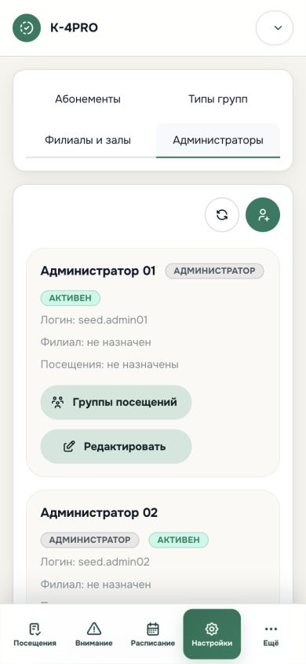

# Настройки — Администраторы

Дата: 20.11.2026. Статус: входящий аналитический материал; не план реализации.

## Задача и границы

Роль: Главный тренер. Понять область работы администратора и изменить разрешённые настройки.

Экспертный проход работающего локального интерфейса. Обозначения: **О** — пройденный путь до указанной границы; **Р** — расчёт по видимым контролам, без сохранения; **Г** — гипотеза предлагаемого пути. Методика и ограничения — в [общем отчёте](../README.md).

## Действия до результата

О: открыть «Группы посещений» — 1 нажатие. Р: назначить одну группу = открыть + выбрать + сохранить = 3; сохранение не выполнялось. Г: те же 3 с достоверной областью филиала и компактным списком.

## Находки и приоритет

- **ADM-01 · high · подтверждено:** список показывает у Администратора 01 «Филиал: не назначен», а загруженный диалог «Группы посещений» — «Филиал: Филиал Центр». Внешний список остаётся с прежним текстом. Это противоречивый контекст одной учётной записи, а не вкусовая оценка. Проверить синхронизацию данных списка и диалога; backend остаётся источником области доступа.
- **ADM-02 · medium · гипотеза:** на 390 px одна карточка занимает около трети рабочей высоты: роль «Администратор», «Активен», логин, область и две большие кнопки. В однородном списке повтор роли не нужен; при смешанных ролях сохранять различение SuperAdministrator.
- «Филиал» и «Посещения» нельзя убрать ради чистоты: это условия работы и доступа.

## Что оставить, скрыть и убрать

Оставить имя, логин, достоверный филиал, область посещений, исключения активности и действия. Скрыть только очевидную повторную роль. Ошибка загрузки области не должна превращаться в утверждение «не назначен».

## Предлагаемый каркас

ФИО / логин → филиал · посещения → [Группы посещений] [Изменить].

Это текстовая гипотеза, не проверенный и не согласованный прототип.

## Проверка и критерии следующего прохода

Снимок attendance-scope и его текст сохраняют противоречие. Проверить обновление списка после диалога, отсутствие назначения, смешанные роли и ограничения. Права, группы и пароли не изменялись.

## Requirements и связи

none — этот отчёт фиксирует наблюдения и предложения; поведение продукта, принятые требования и статусы задач не изменяются. Ограничивающие источники для последующей доработки:

- [05-пользователи-и-роли.md](../../../../docs/requirements/05-пользователи-и-роли.md)
- [09-филиалы-и-настройки.md](../../../../docs/requirements/09-филиалы-и-настройки.md)

## Доказательства

- [attendance-scope.jpg](attendance-scope.jpg) · [структура экрана](attendance-scope.txt)
- [desktop.jpg](desktop.jpg) · [структура экрана](desktop.txt)
- [mobile.jpg](mobile.jpg) · [структура экрана](mobile.txt)

[К общему отчёту и очередности](../README.md)
