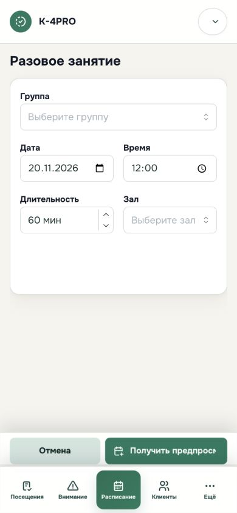

# Разовое занятие

Дата: 20.11.2026. Статус: входящий аналитический материал; не план реализации.

## Задача и границы

Роль: Администратор. Добавить конкретное занятие с правильными датой, временем и залом.

Экспертный проход работающего локального интерфейса. Обозначения: **О** — пройденный путь до указанной границы; **Р** — расчёт по видимым контролам, без сохранения; **Г** — гипотеза предлагаемого пути. Методика и ограничения — в [общем отчёте](../README.md).

## Действия до результата

О: из расписания открыть форму = 1. Р: выбрать группу 2 + дату 1 + время 1 + длительность 1 + зал 2 + предпросмотр 1 = ещё 8; всего 9 до результата предпросмотра при ручном заполнении всех параметров. Окончательное подтверждение не открывалось, полный путь сохранения не измерен. Г: подставлять подтверждённый контекст и сокращать повторные выборы; предпросмотр не удалять без анализа контракта.

## Находки и приоритет

- **LES-01 · medium · гипотеза:** дата наследует день, а время сразу 12:00 и длительность 60 мин. Эти значения могут выглядеть как уже подходящие. Проверить возможность осмысленного заполнения после выбора группы; не считать предустановку ошибкой без выбранного сценария.
- **LES-02 · low · гипотеза:** слово «Получить предпросмотр» описывает технический шаг. «Проверить занятие» может понятнее обозначать результат; сохранить сведения о конфликтах и последствиях.
- Полей немного и все связаны с результатом. Удаление зала/длительности ради короткой формы недопустимо без принятого правила.

## Что оставить, скрыть и убрать

Оставить группу, дату, время, длительность, зал, отмену и проверку. Описание безопасности и конфликтов показывать в соответствующем состоянии, не в постоянном длинном вступлении.

## Предлагаемый каркас

Группа → дата / время / длительность → зал → [Проверить занятие] → подтверждение по существующему контракту.

Это текстовая гипотеза, не проверенный и не согласованный прототип.

## Проверка и критерии следующего прохода

Только начальная форма. Дальше нужны предпросмотр, конфликт зала/тренера, устаревший предпросмотр, ошибка, сохранение и возврат к дню. Автоматическое сохранение не предлагалось.

## Requirements и связи

none — этот отчёт фиксирует наблюдения и предложения; поведение продукта, принятые требования и статусы задач не изменяются. Ограничивающие источники для последующей доработки:

- [02-группы.md](../../../../docs/requirements/02-группы.md)

## Доказательства

- [desktop.jpg](desktop.jpg) · [структура экрана](desktop.txt)
- [mobile.jpg](mobile.jpg) · [структура экрана](mobile.txt)

[К общему отчёту и очередности](../README.md)
