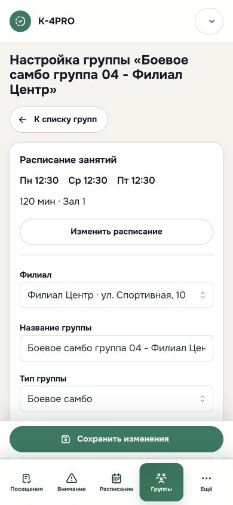

# Настройка существующей группы

Дата: 20.11.2026. Статус: входящий аналитический материал; не план реализации.

## Задача и границы

Роль: Главный тренер. Изменить конкретный аспект группы, не затрагивая остальные операции.

Экспертный проход работающего локального интерфейса. Обозначения: **О** — пройденный путь до указанной границы; **Р** — расчёт по видимым контролам, без сохранения; **Г** — гипотеза предлагаемого пути. Методика и ограничения — в [общем отчёте](../README.md).

## Действия до результата

Р: переименование из списка = открыть 1 + ввод 1 + сохранить 1 = 3. Назначение тренера требует отдельного предпросмотра и сохранения; полный путь не проходился. Г: сохранить независимые операции и подтверждения, уменьшить число лишних блоков перед нужной частью.

## Находки и приоритет

- **GED-01 · medium · подтверждённый шум:** блок временных замещений сообщает об отключённом изменении, отсутствии текущих записей, нулевой истории и будущей возможности. При пустых данных он не поддерживает доступное действие. Свернуть в «История замещений», показывать подробности только при наличии записей/запросе.
- **GED-02 · medium · гипотеза:** выбранные филиал и тип повторяются статической сводкой под полями. Убрать сводку, если она не подтверждает отдельный этап.
- **GED-03 · medium · подтверждено:** в списке клиентов группы виден сырой статус Active. Нужна локализованная серверная семантика, не собственное вычисление статуса на frontend.
- Три области сохранения (основные данные, расписание, тренеры) нельзя объединить одной кнопкой без согласованного контракта атомарности.

## Что оставить, скрыть и убрать

Оставить обзор расписания и прямое изменение, основные поля, назначения тренеров. Убрать тексты про будущую разработку. Исторические записи сохранять; сворачивается представление, не данные.

## Предлагаемый каркас

Основные данные [Сохранить] → Расписание [Изменить] → Тренеры [Изменить назначения] → Клиенты → История по запросу.

Это текстовая гипотеза, не проверенный и не согласованный прототип.

## Проверка и критерии следующего прохода

Открыта существующая группа; изменения не сохранены. Проверить локализацию статусов, пустую/непустую историю, независимые несохранённые изменения и последствия назначения.

## Requirements и связи

none — этот отчёт фиксирует наблюдения и предложения; поведение продукта, принятые требования и статусы задач не изменяются. Ограничивающие источники для последующей доработки:

- [02-группы.md](../../../../docs/requirements/02-группы.md)
- [08-нефункциональные.md](../../../../docs/requirements/08-нефункциональные.md)

## Доказательства

- [edit-full.jpg](edit-full.jpg) · полный снимок страницы
- [edit-mobile.jpg](edit-mobile.jpg) · [структура экрана](edit-mobile.txt)

[К общему отчёту и очередности](../README.md)
