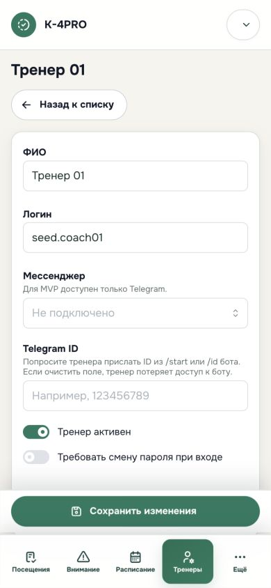

# Редактирование тренера

Дата: 20.11.2026. Статус: входящий аналитический материал; не план реализации.

## Задача и границы

Роль: Главный тренер. Исправить данные сотрудника и привязку Telegram.

Экспертный проход работающего локального интерфейса. Обозначения: **О** — пройденный путь до указанной границы; **Р** — расчёт по видимым контролам, без сохранения; **Г** — гипотеза предлагаемого пути. Методика и ограничения — в [общем отчёте](../README.md).

## Действия до результата

Р: из списка до изменения ФИО — открыть + ввод + сохранить = 3. Привязка Telegram ID также 3, но получение ID от тренера — отдельная внешняя работа. Г: число сохранить; убрать лишнее решение выбора платформы, если она действительно одна.

## Находки и приоритет

- **CED-01 · low · гипотеза:** «Для MVP доступен только Telegram» — текст о стадии разработки, не рабочая инструкция. Если платформа одна, показывать Telegram без лишнего выбора; сохранение поля в контракте учесть.
- **CED-02 · medium · полезная информация:** предупреждение о потере доступа при очистке Telegram ID необходимо. Его нельзя удалять вместе со справочным шумом.
- **CED-03 · кандидат:** логин выглядит текстовым полем; требование запрещает менять существующий логин. Readonly/disabled и реакция сервера здесь не проверялись. Проверить визуальное различение неизменяемого значения, не заявлять обход ограничения.

## Что оставить, скрыть и убрать

Оставить ФИО, логин как идентификатор, Telegram ID, активность и обязательную смену пароля. Техническое слово MVP убрать. Пример ID и способ его получения нужны рядом с вводом.

## Предлагаемый каркас

ФИО → логин (неизменяемый) → Telegram ID + последствия очистки → состояние → сохранить.

Это текстовая гипотеза, не проверенный и не согласованный прототип.

## Проверка и критерии следующего прохода

Проверен просмотр. Изменение, отключение аккаунта и очистка ID не выполнялись. После правки: readonly логин, дубликат ID, область действия на все филиалы, доступ Administrator.

## Requirements и связи

none — этот отчёт фиксирует наблюдения и предложения; поведение продукта, принятые требования и статусы задач не изменяются. Ограничивающие источники для последующей доработки:

- [05-пользователи-и-роли.md](../../../../docs/requirements/05-пользователи-и-роли.md)

## Доказательства

- [edit-mobile.jpg](edit-mobile.jpg) · [структура экрана](edit-mobile.txt)

[К общему отчёту и очередности](../README.md)
