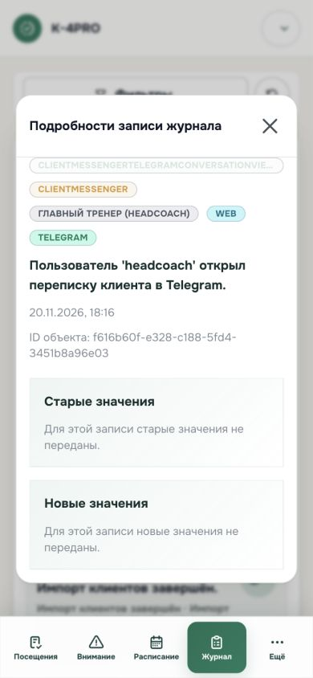

# Подробности записи журнала

Дата: 20.11.2026. Статус: входящий аналитический материал; не план реализации.

## Задача и границы

Роль: Главный тренер. Понять содержание одного события и вернуться на прежнюю запись.

Экспертный проход работающего локального интерфейса. Обозначения: **О** — пройденный путь до указанной границы; **Р** — расчёт по видимым контролам, без сохранения; **Г** — гипотеза предлагаемого пути. Методика и ограничения — в [общем отчёте](../README.md).

## Действия до результата

О: открыть детали → закрыть Escape = 2 действия. Фокус после Escape вернулся на исходную кнопку. Г: сохранить 2, улучшить порядок сведений.

## Находки и приоритет

- **ADE-01 · medium · гипотеза:** сверху сначала несколько технических меток, затем человеческое описание. Поменять приоритет: событие, время, автор, изменения; технические идентификаторы ниже.
- **ADE-02 · low · гипотеза:** для события просмотра два блока сообщают, что старые и новые значения не переданы. Объединить в одно «Изменения данных не переданы для этого события» либо показывать раздел изменений только при наличии. Не утверждать, что изменений не было: отсутствие payload и отсутствие изменения — разные факты.
- UUID в деталях полезен для диагностики. Удалять его из продукта полностью не нужно.

## Что оставить, скрыть и убрать

Оставить полный текст, время, автора и исходные значения, когда они есть. Технические типы и ID — раскрываемые подробности. Убрать повторные пустые блоки без потери смысла.

## Предлагаемый каркас

Описание → время / автор → изменения → технические сведения → закрыть.

Это текстовая гипотеза, не проверенный и не согласованный прототип.

## Проверка и критерии следующего прохода

Проверено одно событие просмотра и Escape/фокус. Сравнить изменение с before/after, большое значение, отсутствующий payload и неизвестный тип; screen reader отдельно.

## Requirements и связи

none — этот отчёт фиксирует наблюдения и предложения; поведение продукта, принятые требования и статусы задач не изменяются. Ограничивающие источники для последующей доработки:

- [06-аудит.md](../../../../docs/requirements/06-аудит.md)
- [TASK-107-audit-log-mobile-density-focus.md](../../../done/2026-08-22/TASK-107-audit-log-mobile-density-focus.md)

## Доказательства

- [details-mobile.jpg](details-mobile.jpg) · [структура экрана](details-mobile.txt)

[К общему отчёту и очередности](../README.md)
