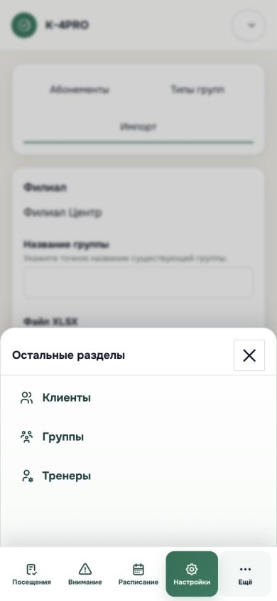

# Общая навигация

Дата: 20.11.2026. Статус: входящий аналитический материал; не план реализации.

## Задача и границы

Роль: Главный тренер и Администратор. Быстро перейти к нужной работе и вернуться к предыдущему контексту.

Экспертный проход работающего локального интерфейса. Обозначения: **О** — пройденный путь до указанной границы; **Р** — расчёт по видимым контролам, без сохранения; **Г** — гипотеза предлагаемого пути. Методика и ограничения — в [общем отчёте](../README.md).

## Действия до результата

О: основной раздел — 1 нажатие. На телефоне скрытый раздел — 2: «Ещё» → раздел. После открытия настроек возвращение в «Клиенты» также требует 2 действий: четвёртая позиция уже занята настройками. Г: фиксированный четвёртый пункт вернёт переход к клиентам к 1 действию, но добавит одно действие для повторного входа в настройки.

## Находки и приоритет

- **NAV-01 · medium · гипотеза:** четвёртый пункт нижней навигации меняется с «Клиенты» на открытый вторичный раздел. Это сохраняет видимость текущего раздела, но меняет привычное место перехода. Сравнить с постоянными «Клиенты» + активным состоянием «Ещё». Не менять без выбора владельца.
- **NAV-02 · medium · подтверждено:** переходы разделов представлены кнопками, а не ссылками. Нативное открытие в новой вкладке не предоставляется. Это уже предусмотрено REQ-NFR-001 и TASK-181; новую дублирующую задачу не создавать.
- **NAV-03 · low · гипотеза:** повторяющиеся кнопки обновления занимают место в первых панелях. Оставлять ручное восстановление после ошибки/устаревания; удалять постоянное обновление можно только после проверки принятой модели актуальности.

## Что оставить, скрыть и убрать

Оставить: текущий раздел, профиль и доступные по роли разделы. Объединить: одинаковый способ возврата в список. Не добавлять к каждой вкладке декоративный заголовок или карточку статистики. Не убирать «Ещё», пока во всех ролях остаётся доступ ко всем разделам.

## Предлагаемый каркас

Телефон: [Посещения] [Внимание] [Расписание] [Клиенты?] [Ещё]. Вопросительный знак — открытый выбор владельца, не утверждённый дизайн.

Это текстовая гипотеза, не проверенный и не согласованный прототип.

## Проверка и критерии следующего прохода

Переход в скрытый раздел и обратно проверен. После изменения проверить клавиатуру, нативное открытие ссылок, возврат поиска/прокрутки и все роли. Роль Coach и SuperAdministrator в этой сессии не проходились.

## Requirements и связи

none — этот отчёт фиксирует наблюдения и предложения; поведение продукта, принятые требования и статусы задач не изменяются. Ограничивающие источники для последующей доработки:

- [appRoutes.ts](../../../../frontend/src/lib/appRoutes.ts)
- [08-нефункциональные.md](../../../../docs/requirements/08-нефункциональные.md)
- [TASK-181-native-navigation-links.md](../../../tasks-ready/TASK-181-native-navigation-links.md)

## Доказательства

- [mobile-menu.jpg](mobile-menu.jpg) · [структура экрана](mobile-menu.txt)

[К общему отчёту и очередности](../README.md)

## Результат разбора 20.11.2026

Исходный текст выше сохранён как история аудита. Текущая классификация, связанные задачи и отложенные предложения — в [результате разбора](../TRIAGE.md). Статус «обработано» относится к источнику и не означает выполнения найденных доработок.
