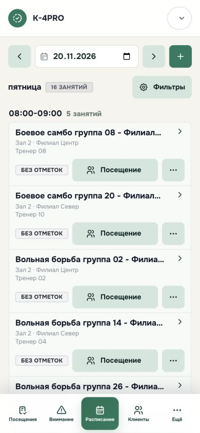

# Расписание — день

Дата: 20.11.2026. Статус: входящий аналитический материал; не план реализации.

## Задача и границы

Роль: Главный тренер. Найти занятие по времени и перейти к посещению или изменению.

Экспертный проход работающего локального интерфейса. Обозначения: **О** — пройденный путь до указанной границы; **Р** — расчёт по видимым контролам, без сохранения; **Г** — гипотеза предлагаемого пути. Методика и ограничения — в [общем отчёте](../README.md).

## Действия до результата

О: из дня открыть посещение выбранного занятия — 1 нажатие. О: перейти к форме разового занятия — 1. Изменение дня стрелкой — 1 на каждый день. Г: сохранить прямое посещение; быстрый переход к сегодняшнему дню сравнить отдельно.

## Находки и приоритет

- **SCH-01 · medium · гипотеза:** в мобильном списке каждое занятие содержит крупную отдельную строку действий с одинаковым «Без отметок». Пять одновременных занятий занимают почти весь экран; сравнить более компактную строку действий без потери прямого «Посещение».
- **SCH-02 · medium · гипотеза:** название группы обрезается, хотя ниже повторяется филиал из названия. Можно дать названию две строки, а место — одну компактную. Не удалять различающие части пользовательского названия.
- **SCH-03 · low · существующий пробел:** день недели показан отдельно от календарной даты. Объединение с датой уже есть в TASK-182. Дата нужна, а не является декоративным мусором.

## Что оставить, скрыть и убрать

Оставить: дату, время, группу, зал/филиал, назначенного тренера, явную возможность посещения. Вторичные операции изменения оставить в «Ещё». Счётчик занятий полезен при оценке заполненности дня, но не нужен дубль в каждом дополнительном заголовке.

## Предлагаемый каркас

[←] [пт, 20 ноября] [→] [+] [Фильтры] → время → группа / место / тренер → посещение / ещё.

Это текстовая гипотеза, не проверенный и не согласованный прототип.

## Проверка и критерии следующего прохода

Проверен мобильный день с 16 занятиями и создание. Настольный снимок исключён из доказательств из-за неполного захвата при смене размера окна; визуальная приёмка desktop-расписания остаётся непроверенной. При доработке: одновременные занятия, длинные названия, отменённое/перенесённое занятие, прошлый и будущий день. Эти изменённые состояния сейчас не моделировались.

## Requirements и связи

none — этот отчёт фиксирует наблюдения и предложения; поведение продукта, принятые требования и статусы задач не изменяются. Ограничивающие источники для последующей доработки:

- [02-группы.md](../../../../docs/requirements/02-группы.md)
- [TASK-182-schedule-weekday-calendar-date.md](../../../tasks-ready/TASK-182-schedule-weekday-calendar-date.md)
- [TASK-157-schedule-mobile-density.md](../../../done/2026-08-30/TASK-157-schedule-mobile-density.md)

## Доказательства

- [mobile.jpg](mobile.jpg) · [структура экрана](mobile.txt)

[К общему отчёту и очередности](../README.md)

## Результат разбора 20.11.2026

Исходный текст выше сохранён как история аудита. Текущая классификация, связанные задачи и отложенные предложения — в [результате разбора](../TRIAGE.md). Статус «обработано» относится к источнику и не означает выполнения найденных доработок.
