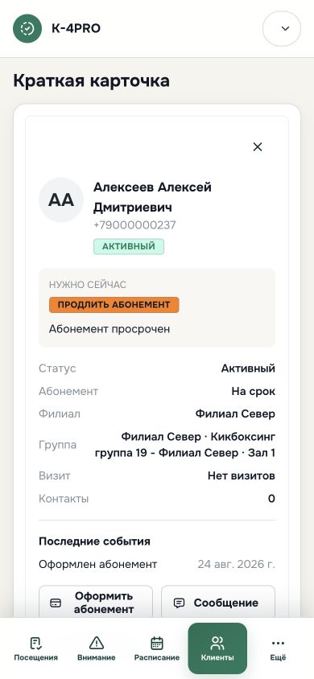

# Краткая карточка клиента

Дата: 20.11.2026. Статус: входящий аналитический материал; не план реализации.

## Задача и границы

Роль: Главный тренер. Понять нужное действие и сразу начать его.

Экспертный проход работающего локального интерфейса. Обозначения: **О** — пройденный путь до указанной границы; **Р** — расчёт по видимым контролам, без сохранения; **Г** — гипотеза предлагаемого пути. Методика и ограничения — в [общем отчёте](../README.md).

## Действия до результата

О: список → краткая карточка → «Оформить абонемент» = 2 нажатия, но открывается полная карточка без формы. До формы продления нужен ещё «Продлить»: 3 нажатия, плюс прокрутка; поиск добавляет 1. Г: действие из краткой карточки открывает нужную форму: 2 вместо 3 из списка. Сохранение продажи отдельно.

## Находки и приоритет

- **PRE-01 · high · подтверждено:** «Оформить абонемент» не открывает оформление, а переводит в полную карточку. Воспроизведено; quick-membership-destination показывает отсутствие открытой формы. В коде «Оформить», «Сообщение», «Посещение» и «Открыть карточку» вызывают один onOpen. Для двух последних специальных действий вывод по коду, не отдельное runtime-прохождение.
- **PRE-02 · medium · гипотеза:** «Активный» повторён дважды, филиал — отдельным фактом и внутри группы; «Контакты: 0» и «Нет визитов» оттесняют действия вниз. На 390×844 основные действия оказываются у нижнего края/ниже первого экрана.
- Предложение: компактное резюме с одним главным действием, а полные факты — в подробностях.

## Что оставить, скрыть и убрать

Оставить: имя, телефон, различающие данные, серверную причину следующего действия. Убрать повтор статуса; скрыть пустые счётчики. Сведения о контактах нужны при экстренной связи, но ноль не требует постоянного блока. «Продлить» и «Оформить» должны вести к согласованным операциям, а не подменять друг друга.

## Предлагаемый каркас

Имя + контакт → актуальный абонемент/причина → [Продлить] → дополнительные действия → [Полная карточка].

Это текстовая гипотеза, не проверенный и не согласованный прототип.

## Проверка и критерии следующего прохода

Проверять каждую быструю кнопку по достигнутому состоянию, а не по факту перехода. Вернуться в исходный поиск и строку. Учитывать TASK-016 и TASK-019; существенный выбор объединения preview/detail остаётся за владельцем.

## Requirements и связи

none — этот отчёт фиксирует наблюдения и предложения; поведение продукта, принятые требования и статусы задач не изменяются. Ограничивающие источники для последующей доработки:

- [ClientPreviewPanel.tsx](../../../../frontend/src/features/clients/list/ClientPreviewPanel.tsx)
- [TASK-016-client-card-quick-actions.md](../../../needs-clarification/TASK-016-client-card-quick-actions.md)
- [TASK-019-client-card-tabs.md](../../../tasks-ready/TASK-019-client-card-tabs.md)

## Доказательства

- [desktop.jpg](desktop.jpg) · [структура экрана](desktop.txt)
- [mobile.jpg](mobile.jpg) · [структура экрана](mobile.txt)
- [quick-membership-destination.jpg](quick-membership-destination.jpg) · [структура экрана](quick-membership-destination.txt)

[К общему отчёту и очередности](../README.md)

## Результат разбора 20.11.2026

Исходный текст выше сохранён как история аудита. Текущая классификация, связанные задачи и отложенные предложения — в [результате разбора](../TRIAGE.md). Статус «обработано» относится к источнику и не означает выполнения найденных доработок.
