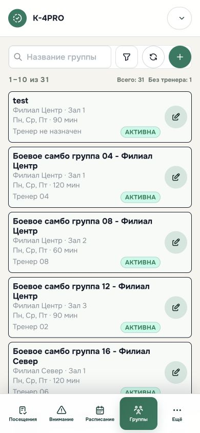

# Группы — список

Дата: 20.11.2026. Статус: входящий аналитический материал; не план реализации.

## Задача и границы

Роль: Главный тренер. Найти группу и перейти к её настройкам.

Экспертный проход работающего локального интерфейса. Обозначения: **О** — пройденный путь до указанной границы; **Р** — расчёт по видимым контролам, без сохранения; **Г** — гипотеза предлагаемого пути. Методика и ограничения — в [общем отчёте](../README.md).

## Действия до результата

О: видимая группа → редактирование = 1 нажатие; с вводом названия = 2. Р: поиск → открыть → изменить название → сохранить = 4 действия для переименования. Г: сохранить число, улучшить различение групп и контекст расписания.

## Находки и приоритет

- **GRP-01 · medium · подтверждённое наблюдение:** в строке расписания показаны дни и длительность, но нет времени начала. Чтобы узнать его, нужно открыть редактирование (1 дополнительный переход). Гипотеза: показывать время в строке, особенно если одинаковые дни у нескольких групп.
- **GRP-02 · low · гипотеза:** «1–10 из 31» и «Всего: 31» дублируют размер списка. Убрать второй счётчик; «Без тренера: 1» оставить лишь как полезный фильтр/сигнал, не декоративную метрику.
- **GRP-03 · low · гипотеза:** «Активна» повторяется на всех видимых строках. Рассмотреть показ только исключений при явно заданном фильтре. Не скрывать архивность и не терять различение состояния.

## Что оставить, скрыть и убрать

Оставить: название, филиал/зал, расписание, тренера/его отсутствие, редактирование. Объединить повтор филиала только на уровне представления метаданных, не менять пользовательское название. Счётчик страниц достаточен без второго общего итога.

## Предлагаемый каркас

[Поиск] [Фильтры] [+] → название / место / дни + время / тренер → редактирование.

Это текстовая гипотеза, не проверенный и не согласованный прототип.

## Проверка и критерии следующего прохода

Проверить несколько времён в недельном расписании, архивные группы, отсутствие тренера, длинные названия и переходы страниц. При нескольких временах не изобретать одно общее время.

## Requirements и связи

none — этот отчёт фиксирует наблюдения и предложения; поведение продукта, принятые требования и статусы задач не изменяются. Ограничивающие источники для последующей доработки:

- [02-группы.md](../../../../docs/requirements/02-группы.md)
- [TASK-164-groups-vertical-budget.md](../../../done/2026-08-30/TASK-164-groups-vertical-budget.md)

## Доказательства

- [desktop.jpg](desktop.jpg) · [структура экрана](desktop.txt)
- [mobile.jpg](mobile.jpg) · [структура экрана](mobile.txt)

[К общему отчёту и очередности](../README.md)

## Результат разбора 20.11.2026

Исходный текст выше сохранён как история аудита. Текущая классификация, связанные задачи и отложенные предложения — в [результате разбора](../TRIAGE.md). Статус «обработано» относится к источнику и не означает выполнения найденных доработок.
