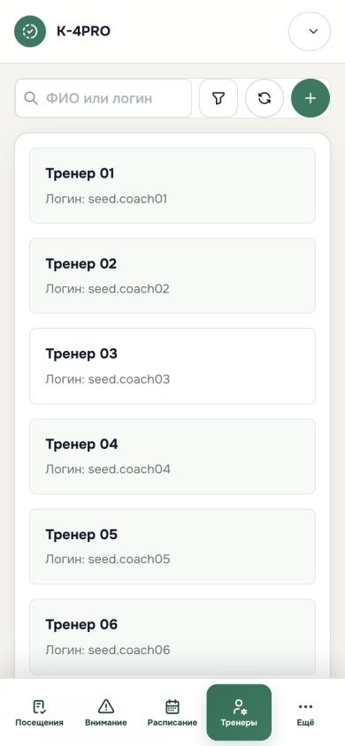

# Тренеры — список

Дата: 20.11.2026. Статус: входящий аналитический материал; не план реализации.

## Задача и границы

Роль: Главный тренер. Найти учётную запись и открыть её редактирование.

Экспертный проход работающего локального интерфейса. Обозначения: **О** — пройденный путь до указанной границы; **Р** — расчёт по видимым контролам, без сохранения; **Г** — гипотеза предлагаемого пути. Методика и ограничения — в [общем отчёте](../README.md).

## Действия до результата

О: видимая строка → форма = 1. Р: поиск → строка → изменение ФИО → сохранить = 4 действия. Г: сохранить 4; сокращать высоту строк без добавления скрытых меню.

## Находки и приоритет

- **COA-01 · low · гипотеза:** на телефоне две строки данных находятся внутри отдельной карточки, а весь список — ещё внутри крупной поверхности. Виден примерно десяток строк только после прокрутки, хотя информации мало. Сравнить простой список с разделителями.
- **COA-02 · low · гипотеза:** постоянное «Логин:» в каждой строке можно заменить вторичным логином без префикса, если семантическая подпись остаётся доступной.
- В отличие от карточки клиента здесь мало содержательного мусора: не добавлять статистику, группы и дублирующий статус ради заполнения desktop.

## Что оставить, скрыть и убрать

Оставить ФИО и логин для различения аккаунтов. Редактирование всей строки уже экономит действия. Фильтры и создание оставить доступны; проблемы активности/смены пароля должны оставаться заметными, когда присутствуют.

## Предлагаемый каркас

[ФИО или логин] [Фильтры] [+] → ФИО / логин → форма.

Это текстовая гипотеза, не проверенный и не согласованный прототип.

## Проверка и критерии следующего прохода

Проверить длинные ФИО, одинаковые имена, отключённого тренера и обязательную смену пароля. Эти дополнительные состояния не были представлены в текущем наборе.

## Requirements и связи

none — этот отчёт фиксирует наблюдения и предложения; поведение продукта, принятые требования и статусы задач не изменяются. Ограничивающие источники для последующей доработки:

- [05-пользователи-и-роли.md](../../../../docs/requirements/05-пользователи-и-роли.md)
- [DESIGN.md](../../../../frontend/DESIGN.md)

## Доказательства

- [desktop.jpg](desktop.jpg) · [структура экрана](desktop.txt)
- [mobile.jpg](mobile.jpg) · [структура экрана](mobile.txt)

[К общему отчёту и очередности](../README.md)

## Результат разбора 20.11.2026

Исходный текст выше сохранён как история аудита. Текущая классификация, связанные задачи и отложенные предложения — в [результате разбора](../TRIAGE.md). Статус «обработано» относится к источнику и не означает выполнения найденных доработок.
