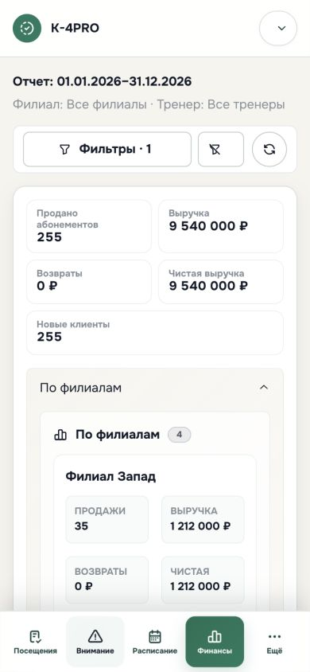

# Финансы

Дата: 20.11.2026. Статус: входящий аналитический материал; не план реализации.

## Задача и границы

Роль: Главный тренер. Получить итог за период и сравнить нужный разрез.

Экспертный проход работающего локального интерфейса. Обозначения: **О** — пройденный путь до указанной границы; **Р** — расчёт по видимым контролам, без сохранения; **Г** — гипотеза предлагаемого пути. Методика и ограничения — в [общем отчёте](../README.md).

## Действия до результата

О: на телефоне месяц → год = 3 действия: «Фильтры» → «Год» → «Готово». На desktop переключатель периода доступен непосредственно (модель 1 нажатия). Г: быстрый период вне панели даст 1 вместо 3 на телефоне ценой дополнительного ряда. Выбор владельца нужен до реализации.

## Находки и приоритет

- **FIN-01 · medium · подтверждено:** одинаковый длинный абзац о дублях повторяется перед тренерами и группами. REQ-SUB-010 уже требует одного общего предупреждения; TASK-184 покрывает исправление.
- **FIN-02 · medium · подтверждённое наблюдение / гипотеза:** «По филиалам» повторено заголовком раскрывающего блока и внутренней карточки; по умолчанию раскрыты все три разреза. На телефоне пять показателей каждого объекта превращают 44 строки разрезов в длинную ленту. Предложить один выбранный разрез либо компактные строки.
- **FIN-03 · low · гипотеза:** большие карточки нулевых возвратов и равной чистой/валовой выручки увеличивают объём. Сохранить все пять показателей, но расположить их компактно; не объявлять разные финансовые понятия дублями только из-за совпавших чисел.

## Что оставить, скрыть и убрать

Оставить: период, область отчёта, все принятые метрики, важное предупреждение о несуммируемости разрезов. Объединить повтор предупреждения. Убрать внутренний дубль заголовка. Не менять серверные расчёты, атрибуцию или смысл нулевых продаж.

## Предлагаемый каркас

Период + фильтры → компактные 5 итогов → одно предупреждение → [Филиалы / Тренеры / Группы] → выбранная детализация.

Это текстовая гипотеза, не проверенный и не согласованный прототип.

## Проверка и критерии следующего прохода

Проверены пустой ноябрь и непустой год, смена периода. После доработки: возврат в другом периоде, Professional, несколько назначений, фильтры и раскрытие обеих зависимых разбивок. Экспорт/сверка сумм с базой не выполнялись.

## Requirements и связи

none — этот отчёт фиксирует наблюдения и предложения; поведение продукта, принятые требования и статусы задач не изменяются. Ограничивающие источники для последующей доработки:

- [03-абонементы-и-оплаты.md](../../../../docs/requirements/03-абонементы-и-оплаты.md)
- [TASK-184-finance-duplicate-warning-once.md](../../../tasks-ready/TASK-184-finance-duplicate-warning-once.md)

## Доказательства

- [desktop-year.jpg](desktop-year.jpg) · [структура экрана](desktop-year.txt)
- [desktop.jpg](desktop.jpg) · [структура экрана](desktop.txt)
- [mobile-empty.jpg](mobile-empty.jpg) · [структура экрана](mobile-empty.txt)
- [mobile-filters.jpg](mobile-filters.jpg) · [структура экрана](mobile-filters.txt)
- [mobile-year.jpg](mobile-year.jpg) · [структура экрана](mobile-year.txt)

[К общему отчёту и очередности](../README.md)

## Результат разбора 20.11.2026

Исходный текст выше сохранён как история аудита. Текущая классификация, связанные задачи и отложенные предложения — в [результате разбора](../TRIAGE.md). Статус «обработано» относится к источнику и не означает выполнения найденных доработок.
