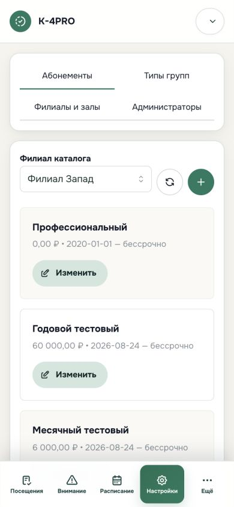

# Настройки — Абонементы

Дата: 20.11.2026. Статус: входящий аналитический материал; не план реализации.

## Задача и границы

Роль: Главный тренер; дополнительно Администратор. Выбрать каталог филиала и изменить вариант абонемента.

Экспертный проход работающего локального интерфейса. Обозначения: **О** — пройденный путь до указанной границы; **Р** — расчёт по видимым контролам, без сохранения; **Г** — гипотеза предлагаемого пути. Методика и ограничения — в [общем отчёте](../README.md).

## Действия до результата

Р: от открытой вкладки изменение названия видимого варианта = «Изменить» + ввод + сохранение = 3 действия. Выбор другого филиала добавляет 2 (раскрыть → выбрать). Г: сохранить число, повысить плотность списка. Форма варианта в этом проходе не отправлялась и не открывалась.

## Находки и приоритет

- **CAT-01 · medium · гипотеза:** название, одна строка метаданных и «Изменить» занимают высокую карточку. На 390 px третий вариант выходит за первый экран. Перенести редактирование вправо, оставить название и цену на двух компактных строках.
- **CAT-02 · medium · подтверждённое наблюдение:** даты доступности показаны в ISO-формате без слов «доступен с», а цена — с копейками даже для целой суммы. Смысл срока доступности легко спутать со сроком действия купленного абонемента. Уточнить подпись и согласовать единый формат в существующих TASK-175/185.
- Профессиональный вариант с 0 ₽ — не ошибка и не мусор: имеет отдельную бизнес-семантику.

## Что оставить, скрыть и убрать

Оставить выбор филиала, название, цену и существенное ограничение доступности. По запросу: давняя дата начала для уже доступного бессрочного варианта. Не скрывать будущую доступность/окончание. Не удалять Professional.

## Предлагаемый каркас

[Филиал каталога] [+] → название / цена / ограничение доступности / изменить.

Это текстовая гипотеза, не проверенный и не согласованный прототип.

## Проверка и критерии следующего прохода

Проверены каталоги разных ролей. После изменения: будущий, закрытый и бессрочный варианты, Professional, ограничения филиала, сохранение/ошибка. Отдельно проверить TASK-179 перед изменением демонстрационных названий.

## Requirements и связи

none — этот отчёт фиксирует наблюдения и предложения; поведение продукта, принятые требования и статусы задач не изменяются. Ограничивающие источники для последующей доработки:

- [03-абонементы-и-оплаты.md](../../../../docs/requirements/03-абонементы-и-оплаты.md)
- [TASK-175-user-visible-date-format.md](../../../needs-clarification/TASK-175-user-visible-date-format.md)
- [TASK-185-ui-copy-and-unit-consistency.md](../../../needs-clarification/TASK-185-ui-copy-and-unit-consistency.md)
- [TASK-179-professional-catalog-seed-presentation.md](../../../needs-clarification/TASK-179-professional-catalog-seed-presentation.md)

## Доказательства

- [desktop.jpg](desktop.jpg) · [структура экрана](desktop.txt)
- [mobile.jpg](mobile.jpg) · [структура экрана](mobile.txt)

[К общему отчёту и очередности](../README.md)

## Результат разбора 20.11.2026

Исходный текст выше сохранён как история аудита. Текущая классификация, связанные задачи и отложенные предложения — в [результате разбора](../TRIAGE.md). Статус «обработано» относится к источнику и не означает выполнения найденных доработок.
