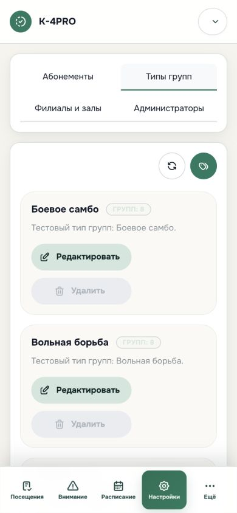

# Настройки — Типы групп

Дата: 20.11.2026. Статус: входящий аналитический материал; не план реализации.

## Задача и границы

Роль: Главный тренер. Поддерживать список направлений тренировок.

Экспертный проход работающего локального интерфейса. Обозначения: **О** — пройденный путь до указанной границы; **Р** — расчёт по видимым контролам, без сохранения; **Г** — гипотеза предлагаемого пути. Методика и ограничения — в [общем отчёте](../README.md).

## Действия до результата

Р: изменить название = открыть редактирование + ввод + сохранить = 3 действия из вкладки. Г: те же 3, больше типов в первом экране. Удаление не выполнялось.

## Находки и приоритет

- **TYP-01 · low · гипотеза:** текст «Тестовый тип групп: Боевое самбо» повторяет название. Это содержимое демонстрационных данных, а не универсально бесполезное поле. Сворачивать описание, когда оно не нужно в списке; реальные описания не стирать.
- **TYP-02 · medium · кандидат проверки:** «Удалить» постоянно отключено у используемых типов; в DOM нет объяснения рядом с кнопкой. Счётчик групп позволяет догадаться, но причина должна быть доступна без наведения. Проверить, не представлена ли она в ином доступном состоянии, прежде чем заводить дефект.
- Счётчик связанных групп полезен для оценки последствий изменения, его не убирать вместе с шумом.

## Что оставить, скрыть и убрать

Оставить название, число использований, редактирование. Описание — раскрывать по запросу. Удаление — вторичная операция с объяснением недоступности, а не ряд одинаковых мёртвых кнопок.

## Предлагаемый каркас

Название · используется в N группах → [Изменить] [Ещё] → описание.

Это текстовая гипотеза, не проверенный и не согласованный прототип.

## Проверка и критерии следующего прохода

Проверить тип без групп и используемый тип, длинное описание, причину запрета удаления, клавиатуру и фокус диалога. Сейчас проверен только заполненный список.

## Requirements и связи

none — этот отчёт фиксирует наблюдения и предложения; поведение продукта, принятые требования и статусы задач не изменяются. Ограничивающие источники для последующей доработки:

- [02-группы.md](../../../../docs/requirements/02-группы.md)
- [09-филиалы-и-настройки.md](../../../../docs/requirements/09-филиалы-и-настройки.md)

## Доказательства

- [desktop.jpg](desktop.jpg) · [структура экрана](desktop.txt)
- [mobile.jpg](mobile.jpg) · [структура экрана](mobile.txt)

[К общему отчёту и очередности](../README.md)

## Результат разбора 20.11.2026

Исходный текст выше сохранён как история аудита. Текущая классификация, связанные задачи и отложенные предложения — в [результате разбора](../TRIAGE.md). Статус «обработано» относится к источнику и не означает выполнения найденных доработок.
