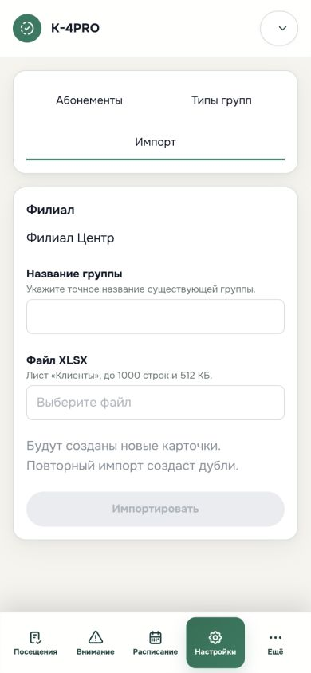

# Настройки — Импорт

Дата: 20.11.2026. Статус: входящий аналитический материал; не план реализации.

## Задача и границы

Роль: Администратор. Загрузить новых клиентов в заранее созданную группу своего филиала.

Экспертный проход работающего локального интерфейса. Обозначения: **О** — пройденный путь до указанной границы; **Р** — расчёт по видимым контролам, без сохранения; **Г** — гипотеза предлагаемого пути. Методика и ограничения — в [общем отчёте](../README.md).

## Действия до результата

Р: из открытых настроек: «Импорт» + ввод точного названия + выбор файла + «Импортировать» = 4 логических действия, без внутренних действий системного выбора файла. Подготовка XLSX и поиск названия группы — внешняя работа, а не ноль действий. Г: число может остаться 4; подсказка группы и образец файла сокращают повторный ввод/ошибки, а не доказанно нажатия.

## Находки и приоритет

- **IMP-01 · medium · гипотеза:** требуется вручную знать точное название существующей группы. Предложить поиск/подсказку доступных групп своего филиала при сохранении заданной контрактом семантики. Это выбор продукта и контракта, не готовая локальная правка.
- **IMP-02 · medium · гипотеза:** форма сообщает имя листа и лимиты, но не показывает структуру колонок и пример. Пользователь должен искать внешний источник. Добавить компактную ссылку на требования к файлу/образец.
- Предупреждение о дублях — необходимая информация, его нельзя убирать как шум. Главный тренер не видит импорт по принятому требованию; это не дефект.

## Что оставить, скрыть и убрать

Оставить филиал, группу, файл, ограничения формата и предупреждение о новых карточках/дублях. Не добавлять автоматическую дедупликацию или создание группы: это противоречит REQ-CLI-010. Отложить длинные инструкции в раскрываемую справку.

## Предлагаемый каркас

Филиал → группа → файл + [Пример структуры] → предупреждение о дублях → Импортировать → результат.

Это текстовая гипотеза, не проверенный и не согласованный прототип.

## Проверка и критерии следующего прохода

Проверены доступ Administrator и отсутствие вкладки у HeadCoach, пустая форма. Файл не загружался. Ошибки колонок, неизвестная группа, повторная загрузка, результат и сетевой сбой требуют отдельного тестового прогона.

## Requirements и связи

none — этот отчёт фиксирует наблюдения и предложения; поведение продукта, принятые требования и статусы задач не изменяются. Ограничивающие источники для последующей доработки:

- [01-клиенты.md](../../../../docs/requirements/01-клиенты.md)
- [ClientImportPanel.tsx](../../../../frontend/src/features/settings/ClientImportPanel.tsx)

## Доказательства

- [desktop.jpg](desktop.jpg) · [структура экрана](desktop.txt)
- [mobile.jpg](mobile.jpg) · [структура экрана](mobile.txt)

[К общему отчёту и очередности](../README.md)

## Результат разбора 20.11.2026

Исходный текст выше сохранён как история аудита. Текущая классификация, связанные задачи и отложенные предложения — в [результате разбора](../TRIAGE.md). Статус «обработано» относится к источнику и не означает выполнения найденных доработок.
