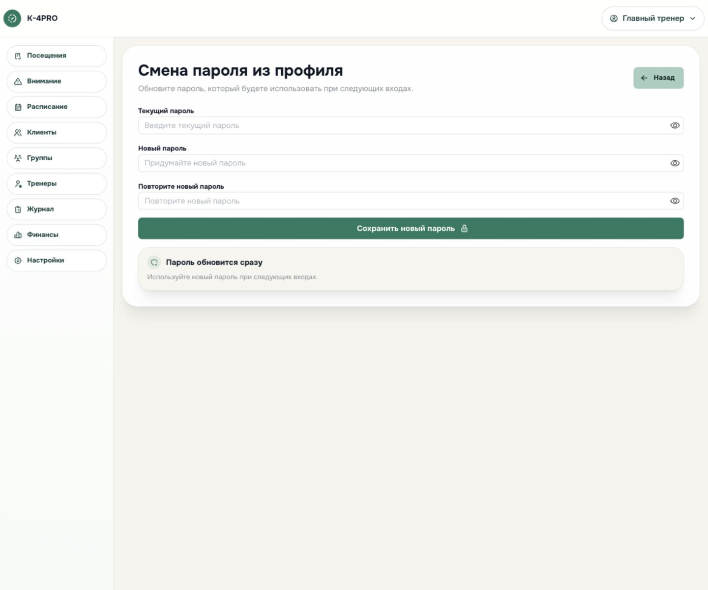

# Профиль — Смена пароля

Дата: 20.11.2026. Статус: входящий аналитический материал; не план реализации.

## Задача и границы

Роль: Главный тренер. Поменять собственный пароль с ясными требованиями и обратной связью.

Экспертный проход работающего локального интерфейса. Обозначения: **О** — пройденный путь до указанной границы; **Р** — расчёт по видимым контролам, без сохранения; **Г** — гипотеза предлагаемого пути. Методика и ограничения — в [общем отчёте](../README.md).

## Действия до результата

О: профиль → «Смена пароля» = 2 перехода до формы. Р: три поля + сохранение = ещё 4, всего 6 логических действий. Г: число не сокращать ценой удаления текущего пароля или подтверждения.

## Находки и приоритет

- **PWD-01 · low · гипотеза:** «Обновите пароль, который будете использовать при следующих входах» и нижнее «Используйте новый пароль при следующих входах» повторяют один смысл. Оставить одну короткую инструкцию.
- **PWD-02 · medium · подтверждено:** кнопки показа пароля имеют английское имя Toggle password visibility в русском интерфейсе. REQ-NFR-001 требует локализации доступных имён; сверить с TASK-176.
- Требования к сложности пароля не выбирать в рамках дизайна: TASK-172 остаётся продуктовым вопросом.

## Что оставить, скрыть и убрать

Оставить три явно подписанных поля, показ/скрытие, возврат и сохранение. Убрать повторные пояснения, но не ошибки и правила, когда они согласованы.

## Предлагаемый каркас

Смена пароля → текущий / новый / повтор → [Сохранить] [Назад].

Это текстовая гипотеза, не проверенный и не согласованный прототип.

## Проверка и критерии следующего прохода

Только просмотр формы. Пароли не вводились и не менялись. Нужны проверка ошибок, фокуса, клавиатуры телефона и завершения самим пользователем в отдельном согласованном сценарии.

## Requirements и связи

none — этот отчёт фиксирует наблюдения и предложения; поведение продукта, принятые требования и статусы задач не изменяются. Ограничивающие источники для последующей доработки:

- [08-нефункциональные.md](../../../../docs/requirements/08-нефункциональные.md)
- [TASK-176-russian-accessibility-and-validation-focus.md](../../../tasks-ready/TASK-176-russian-accessibility-and-validation-focus.md)
- [TASK-172-password-policy.md](../../../done/2026-11-22/TASK-172-password-policy.md)

## Доказательства

- [desktop.jpg](desktop.jpg) · [структура экрана](desktop.txt)

[К общему отчёту и очередности](../README.md)

## Результат разбора 20.11.2026

Исходный текст выше сохранён как история аудита. Текущая классификация, связанные задачи и отложенные предложения — в [результате разбора](../TRIAGE.md). Статус «обработано» относится к источнику и не означает выполнения найденных доработок.
