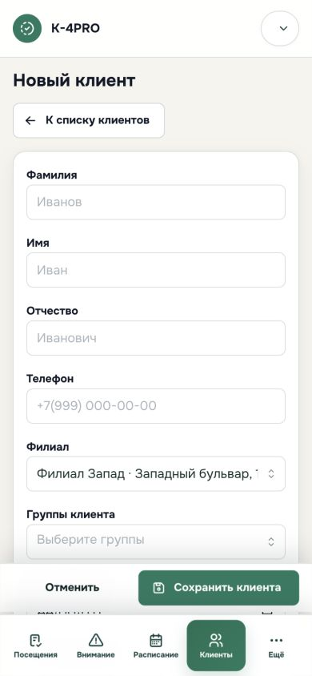

# Новый клиент

Дата: 20.11.2026. Статус: входящий аналитический материал; не план реализации.

## Задача и границы

Роль: Администратор. Создать карточку с нужными данными, не заполняя необязательное заранее.

Экспертный проход работающего локального интерфейса. Обозначения: **О** — пройденный путь до указанной границы; **Р** — расчёт по видимым контролам, без сохранения; **Г** — гипотеза предлагаемого пути. Методика и ограничения — в [общем отчёте](../README.md).

## Действия до результата

О: из списка открыть форму — 1 нажатие. Р: до результата — 1 + F + S + 1, где F — заполненные поля, S — раскрытия и выборы филиала/групп/контактов, последнее 1 — сохранить. Например, три текстовых поля и два действия выбора филиала дают 7; это иллюстрация, не проверенный минимальный допустимый набор. Г: не сокращать обязательный ввод; уменьшить прокрутку и необязательные блоки.

## Находки и приоритет

- **NEW-01 · medium · подтверждённый шум:** крупный блок «Фотография клиента» объясняет, что фото сейчас добавить нельзя, повторяет это вторым текстом и показывает «Фото пока не показано». Свести к короткой подсказке после сохранения; не отнимать место у вводимых данных.
- **NEW-02 · low · гипотеза:** пустые контактные лица представлены заголовком, инструкцией, кнопкой и ещё сообщением об отсутствии. Оставить «Добавить контакт» и краткое пояснение по необходимости.
- **NEW-03 · medium · кандидат:** под Администратором 01 форма предвыбрала Филиал Запад, тогда как импорт использует Филиал Центр. Право создавать клиентов в других филиалах здесь не проверялось; это риск ошибочного выбора, а не установленный дефект авторизации.

## Что оставить, скрыть и убрать

Оставить идентификационные поля, телефон, филиал, группы, дату рождения и доступную заметку. Дополнительные контакты — раскрываемый блок. Убрать пустой просмотр фото до появления операции. Видимые подписи и серверную валидацию сохранить.

## Предлагаемый каркас

Основные данные → филиал/группа → дополнительные сведения → [Сохранить клиента]. Фото предложить после подтверждённого создания.

Это текстовая гипотеза, не проверенный и не согласованный прототип.

## Проверка и критерии следующего прохода

Форма открыта, данные не отправлены. После доработки: обязательность полей по backend, дубликаты телефона по контракту, ошибка сохранения без потери ввода, фото после создания, контакты и возврат.

## Requirements и связи

none — этот отчёт фиксирует наблюдения и предложения; поведение продукта, принятые требования и статусы задач не изменяются. Ограничивающие источники для последующей доработки:

- [01-клиенты.md](../../../../docs/requirements/01-клиенты.md)
- [TASK-018-client-detail-visual-noise.md](../../../tasks-ready/TASK-018-client-detail-visual-noise.md)

## Доказательства

- [desktop.jpg](desktop.jpg) · [структура экрана](desktop.txt)
- [mobile-full.jpg](mobile-full.jpg) · полный снимок страницы
- [mobile.jpg](mobile.jpg) · [структура экрана](mobile.txt)

[К общему отчёту и очередности](../README.md)

## Результат разбора 20.11.2026

Исходный текст выше сохранён как история аудита. Текущая классификация, связанные задачи и отложенные предложения — в [результате разбора](../TRIAGE.md). Статус «обработано» относится к источнику и не означает выполнения найденных доработок.
