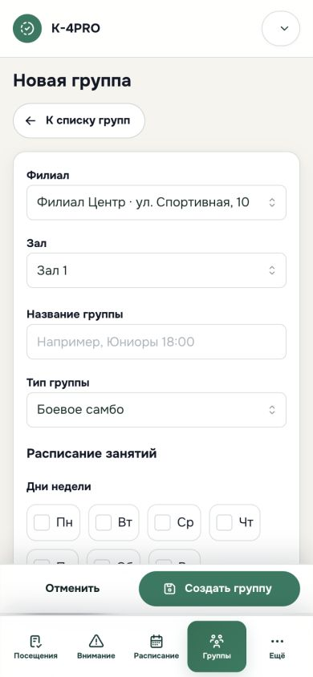

# Новая группа

Дата: 20.11.2026. Статус: входящий аналитический материал; не план реализации.

## Задача и границы

Роль: Администратор. Создать группу вместе с расписанием одним сохранением.

Экспертный проход работающего локального интерфейса. Обозначения: **О** — пройденный путь до указанной границы; **Р** — расчёт по видимым контролам, без сохранения; **Г** — гипотеза предлагаемого пути. Методика и ограничения — в [общем отчёте](../README.md).

## Действия до результата

О: список → форма = 1. Р для 1 дня: открыть форму 1 + название 1 + день 1 + время дня 1 + длительность 1 + создать 1 = 6, если корректны предвыбранные филиал, зал, тип и дата. Смена каждого select добавляет обычно 2, тренеры необязательны. Г: сохранить одно итоговое создание; число обязательных решений не уменьшать искусственно.

## Находки и приоритет

- **GNEW-01 · low · гипотеза:** длинный текст про временное замещение появляется при создании, хотя оно не выполняется здесь. Сократить до подсказки по назначению основного тренера, детали оставить в управлении расписанием.
- **GNEW-02 · low · гипотеза:** необязательные окончание и тренеры можно визуально сгруппировать без сокрытия важного расписания.
- Здесь уже реализован подход «одно создание» TASK-203: не возвращать обязательный отдельный предпросмотр и подтверждение из-за общих дизайнерских предпочтений. Повторное сохранение создания не предлагать.

## Что оставить, скрыть и убрать

Оставить название, область, зал, тип, дни и время, длительность, начало и доступное окончание, тренеров. Предвыбранные значения должны быть легко замечаемы; они влияют на реальный результат и не являются шумом.

## Предлагаемый каркас

Группа/место → расписание → тренеры (необязательно) → [Создать группу].

Это текстовая гипотеза, не проверенный и не согласованный прототип.

## Проверка и критерии следующего прохода

В этом аудите проверен начальный экран; выбор дня, конфликт и успешное создание не выполнялись. Для реализации использовать проверки существующего TASK-203, включая уход с несохранённым вводом и клавиатуру.

## Requirements и связи

none — этот отчёт фиксирует наблюдения и предложения; поведение продукта, принятые требования и статусы задач не изменяются. Ограничивающие источники для последующей доработки:

- [02-группы.md](../../../../docs/requirements/02-группы.md)
- [TASK-203-group-create-single-action.plan.md](../../../done/2026-11-19/TASK-203-group-create-single-action.plan.md)

## Доказательства

- [desktop.jpg](desktop.jpg) · [структура экрана](desktop.txt)
- [mobile.jpg](mobile.jpg) · [структура экрана](mobile.txt)

[К общему отчёту и очередности](../README.md)

## Результат разбора 20.11.2026

Исходный текст выше сохранён как история аудита. Текущая классификация, связанные задачи и отложенные предложения — в [результате разбора](../TRIAGE.md). Статус «обработано» относится к источнику и не означает выполнения найденных доработок.
