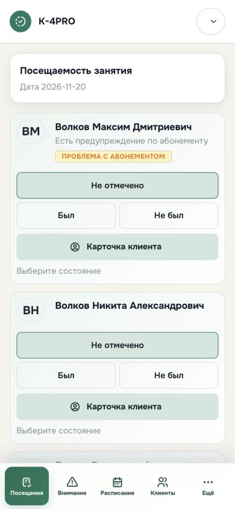

# Посещаемость конкретного занятия

Дата: 20.11.2026. Статус: входящий аналитический материал; не план реализации.

## Задача и границы

Роль: Главный тренер. Отметить нужного клиента, понимая какое занятие изменяется.

Экспертный проход работающего локального интерфейса. Обозначения: **О** — пройденный путь до указанной границы; **Р** — расчёт по видимым контролам, без сохранения; **Г** — гипотеза предлагаемого пути. Методика и ограничения — в [общем отчёте](../README.md).

## Действия до результата

О: список занятий → состав = 1. Р: «Был» или «Не был» добавляет 1, итого 2; отправка отметки не выполнялась. Для N клиентов модель 1+N, без поиска и прокрутки. Г: сохранить 1+N и уменьшить прокрутку; массовую отметку не добавлять.

## Находки и приоритет

- **ROS-01 · high · подтверждено:** шапка сообщает только «Посещаемость занятия» и «Дата 2026-11-20»; название группы и время исчезают после перехода. При нескольких занятиях в один день невозможно проверить контекст по видимой шапке. Сохранить группу, дату и время, а также явный возврат к списку.
- **ROS-02 · medium · подтверждённые повторы:** у проблемного клиента «Есть предупреждение по абонементу» + «Проблема с абонементом»; у каждой строки «Выберите состояние» повторяет назначение трёх переключателей. На 390×844 видны примерно две карточки.
- **ROS-03 · medium · гипотеза:** «Карточка клиента» занимает полную отдельную строку у каждого человека. Открывать карточку по имени или компактной подписанной кнопке, не смешивая нажатие на имя с отметкой.
- Переключатель полного состава не виден в данном маршруте. Требование REQ-ATT-001 его предусматривает; состояние после отметки не проверялось, поэтому это кандидат отдельной проверки, а не заявленная потеря записей.

## Что оставить, скрыть и убрать

Оставить три разных состояния, имя, значимое серверное предупреждение и подтверждение сохранения/ошибки. Свести два общих предупреждения к одному содержательному. Убрать «Выберите состояние» после очевидного выбора. Массовое «все были» противоречит принятому требованию.

## Предлагаемый каркас

Группа · 20 ноября · 08:00–09:00 [К занятиям] → ФИО + предупреждение → [Не отмечено] [Был] [Не был].

Это текстовая гипотеза, не проверенный и не согласованный прототип.

## Проверка и критерии следующего прохода

Проверены 390 и 440, отсутствие горизонтального overflow на 390. После изменения: отметить/вернуть, полный состав, запрет будущей даты, ошибка без ложного успеха и возврат из клиента. Эти операции с записью сейчас не выполнялись.

## Requirements и связи

none — этот отчёт фиксирует наблюдения и предложения; поведение продукта, принятые требования и статусы задач не изменяются. Ограничивающие источники для последующей доработки:

- [04-посещения.md](../../../../docs/requirements/04-посещения.md)
- [AttendanceScreen.tsx](../../../../frontend/src/features/attendance/AttendanceScreen.tsx)

## Доказательства

- [lesson-440.jpg](lesson-440.jpg) · [структура экрана](lesson-440.txt)
- [lesson-desktop.jpg](lesson-desktop.jpg) · [структура экрана](lesson-desktop.txt)
- [lesson-mobile.jpg](lesson-mobile.jpg) · [структура экрана](lesson-mobile.txt)

[К общему отчёту и очередности](../README.md)

## Результат разбора 20.11.2026

Исходный текст выше сохранён как история аудита. Текущая классификация, связанные задачи и отложенные предложения — в [результате разбора](../TRIAGE.md). Статус «обработано» относится к источнику и не означает выполнения найденных доработок.
