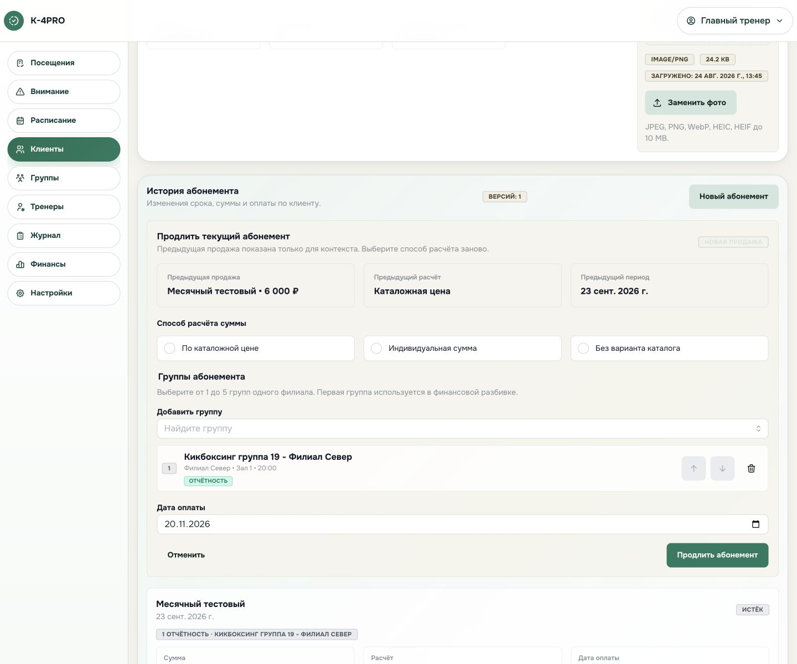

# Продление абонемента

Дата: 20.11.2026. Статус: входящий аналитический материал; не план реализации.

## Задача и границы

Роль: Главный тренер. Создать новую продажу с понятными суммой, периодом и группами.

Экспертный проход работающего локального интерфейса. Обозначения: **О** — пройденный путь до указанной границы; **Р** — расчёт по видимым контролам, без сохранения; **Г** — гипотеза предлагаемого пути. Методика и ограничения — в [общем отчёте](../README.md).

## Действия до результата

О: в полной карточке «Продлить» открывает форму за 1 нажатие. Р: полный путь = 1 + выбор способа расчёта 1 + F значений/выборов + финальное подтверждение 1. F зависит от режима и выбранного каталога; единое точное число без прохождения режимов было бы выдумкой. Г: убрать повторную навигацию из краткой карточки, но сохранить явный выбор нового расчёта.

## Находки и приоритет

- **REN-01 · medium · гипотеза:** форма открывается внутри длинной карточки, при этом ниже остаются предыдущая продажа, перенос группы и история. Операция теряется среди просмотра. Рассмотреть отдельную рабочую область с кратким контекстом предыдущей покупки.
- **REN-02 · low · гипотеза:** для единственной группы показаны неактивные кнопки поднять/опустить. Скрывать управление порядком, когда менять нечего; возвращать его при нескольких группах.
- Предыдущая сумма и предупреждение о новом расчёте полезны, но не должны восприниматься как уже выбранные условия. Нельзя автоматически повторить старую цену ради экономии клика.

## Что оставить, скрыть и убрать

Оставить предыдущую покупку кратко, способ расчёта, группы/порядок отчётности, дату оплаты и нужные поля режима. Историю и перенос групп скрывать на время операции или держать вне формы. Не убирать смысл «новая продажа».

## Предлагаемый каркас

Клиент → предыдущая покупка одной строкой → расчёт / вариант / период → группы → оплата → [Продлить] [Отмена].

Это текстовая гипотеза, не проверенный и не согласованный прототип.

## Проверка и критерии следующего прохода

Форма открыта и отменена, продажа не создавалась. Проверить все три режима суммы, несколько групп, Professional, конфликт, ошибку, отмену и возврат. Выбор нового контейнера требует прототипа.

## Requirements и связи

none — этот отчёт фиксирует наблюдения и предложения; поведение продукта, принятые требования и статусы задач не изменяются. Ограничивающие источники для последующей доработки:

- [03-абонементы-и-оплаты.md](../../../../docs/requirements/03-абонементы-и-оплаты.md)
- [TASK-016-client-card-quick-actions.md](../../../risky/TASK-016-client-card-quick-actions.md)

## Доказательства

- [renewal.jpg](renewal.jpg) · [структура экрана](renewal.txt)

[К общему отчёту и очередности](../README.md)

## Результат разбора 20.11.2026

Исходный текст выше сохранён как история аудита. Текущая классификация, связанные задачи и отложенные предложения — в [результате разбора](../TRIAGE.md). Статус «обработано» относится к источнику и не означает выполнения найденных доработок.
